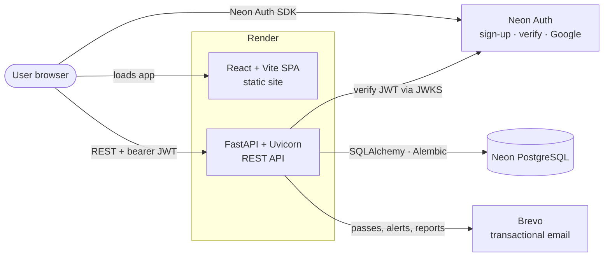

<div align="center">


<br>

<b>A full-stack technology community and events platform</b><br>
<sub>Technical articles and discussion · Professional profiles and a personalised feed · Summits and founder meets · QR-verified digital event passes · Admin and staff operations</sub>

<br><br>

<a href="https://react.dev/"></a>
<a href="https://vite.dev/"></a>
<a href="https://fastapi.tiangolo.com/"></a>
<a href="https://www.python.org/"></a>
<a href="https://www.sqlalchemy.org/"></a>
<a href="https://neon.com/"></a>
<a href="https://render.com/"></a>

<br><br>

<a href="https://techtalk-frontend-acvb.onrender.com"></a>
&nbsp;
<a href="https://techtalk-backendd.onrender.com/docs"></a>
&nbsp;
<a href="https://github.com/ruchirachowdary-1836/nexzibytefull"></a>

<br>
<sub>Hosted on Render's free tier. The first request after a quiet period can take up to a minute while the service wakes up.</sub>

<br><br>

<a href="#overview">Overview</a> ·
<a href="#key-features">Features</a> ·
<a href="#architecture">Architecture</a> ·
<a href="#getting-started">Getting Started</a> ·
<a href="#configuration">Configuration</a> ·
<a href="#roadmap">Roadmap</a>

</div>


## Contents

| Product | Engineering | Project |
|---|---|---|
| [Overview](#overview) | [Architecture](#architecture) | [Roadmap](#roadmap) |
| [Product Vision](#product-vision) | [Technology Stack](#technology-stack) | [Contributing](#contributing) |
| [Key Features](#key-features) | [Project Structure](#project-structure) | [License](#license) |
| [Platform Experience](#platform-experience) | [Getting Started](#getting-started) | [Author](#author) |
| [Screenshots](#screenshots) | [Configuration](#configuration) · [Deployment](#deployment) | |
| | [Quality and Security](#quality-and-security) | |

## Overview

**NexziByte TechTalk** is a community platform for people who build with technology: developers, students, founders and industry speakers. In one product it combines:

- a **knowledge layer** of technical articles and discussion;
- a **professional network** of member profiles, follows and a personalised feed;
- an **events layer** of TechTalk Summits and Founder Meets, with registration, QR-signed digital passes and on-site check-in;
- an **operations layer** that gives admins and staff dashboards, approvals, email logs and scheduled reports.

It is built as a **React + Vite single-page app** talking over HTTPS to a **FastAPI REST API**, backed by **PostgreSQL on Neon**. Identity is handled by **Neon Auth**, and the API verifies its tokens on every protected request.

## Product Vision

| | |
|---|---|
| **The problem** | Technology communities are fragmented. Articles live on one site, event sign-ups on another, and networking happens in spreadsheets and chat groups. Organisers piece together registrations, passes and follow-ups by hand. |
| **The audience** | Technology enthusiasts and builders who want to learn and connect, founders looking for peers and visibility, and the organising team running summits and meetups. |
| **The experience** | One account to read and publish technical content, build a professional profile, follow people, register for events, and carry a digital pass to the door, where staff scan it. |
| **The engineering** | Clear separation between a static SPA and a stateless API, versioned schema migrations, server-side role enforcement, signed QR payloads and CI quality gates. |


## Key Features

All features below are implemented in this repository. Items still under way are listed in the [Roadmap](#roadmap).

<table>
<tr>
<td width="50%" valign="top">

### `01` Community

- **Professional profiles.** Bio, location, current company, skills, experience, education and social links, so members show who they are and what they build.
- **Follow graph.** Follow or unfollow members and see followers and following lists to grow a personal network.
- **Personalised feed.** A `/feed` of posts shaped by who you follow, which keeps relevant content up front.
- **Notifications.** Unread counts and mark-as-read, so members don't miss activity.

</td>
<td width="50%" valign="top">

### `02` Knowledge

- **Posts with a lifecycle.** Create, draft, publish, edit and archive articles, so authors control when work goes live.
- **Categories and tags.** Including trending categories and posts, which makes discovery easy.
- **Search and related posts.** Find articles and continue reading on related topics.
- **Comments, reactions and saves.** Discuss, react and bookmark posts to build a personal reading list.

</td>
</tr>
<tr>
<td width="50%" valign="top">

### `03` Events

- **TechTalk Summits and Founder Meets.** Listings and detail pages with agendas, speakers, sponsors and related events.
- **Reusable speaker profiles.** One speaker record can appear at many events without duplicated data.
- **Registration and passes.** Register once per event, view your passes, and resend the confirmation email.
- **QR-signed digital passes.** Pass QR codes carry a server-signed payload. Staff validate them with the in-app scanner, and each pass can be checked in only once.

</td>
<td width="50%" valign="top">

### `04` Programs & Outreach

- **Courses and internships.** Discovery pages with application forms stored on the backend.
- **Pass tiers and checkout.** Tiered pricing with group (delegation) pricing and coupon codes before a pass request is submitted.
- **Visitor trial pass.** On a configured promotion date, an approved, verified user can activate a ten-minute visitor session that the server enforces.
- **Contact, partnership and newsletter.** Inquiries and subscriptions are saved to the database, with contact alerts sent by email.

</td>
</tr>
<tr>
<td colspan="2" valign="top">

### `05` Platform Infrastructure

- **Three server-enforced roles.** `user`, `staff` and `admin`. Staff run check-ins and the staff dashboard. Admins manage users and roles, posts, events, registrations, pass approvals, course applications, subscribers and email logs.
- **Transactional email via Brevo.** Registration and pass emails, contact notifications, and **scheduled weekly / monthly / yearly admin reports** (plus an on-demand send).
- **Database-backed content catalogs.** Courses, speakers, internships, events, articles, testimonials, FAQs and pricing tiers are served from `static_*` tables through `/content/{catalog}`.
- **Operational endpoints.** `/health`, `/ready` and `/metrics`, structured logs with request IDs, and a background job that cleans up expired records and stale unverified accounts.

</td>
</tr>
</table>

## Platform Experience

```text
 Visitor ──► Discover ──► Sign up ──► Build profile ──► Engage ──► Attend
            articles,    Neon Auth   company, skills,  post, comment, register → digital pass
            summits,     (email or   experience,       react, save,   → QR scanned by staff
            speakers     Google)     education         follow, feed   → checked in
```

1. **Discover.** Visitors browse the landing page, articles, summits, founder meets, speakers, courses and internships.
2. **Join.** Members sign up through Neon Auth with email and password or Google, then verify their email.
3. **Build a presence.** They complete a professional profile and follow other members to shape their feed.
4. **Engage.** Members publish posts, comment, react and save articles, and receive notifications.
5. **Attend.** Members choose a pass tier, register for an event, and receive a QR-signed digital pass by email and under **My Passes**.
6. **Check in.** At the venue, staff scan the pass in the **QR scanner**, and the API validates the signature and status before admitting the holder.
7. **Operate.** Admins approve pass requests, manage content and people, and receive scheduled email reports.

## Screenshots

The repository doesn't include product screenshots yet. You can explore the **[live platform](https://techtalk-frontend-acvb.onrender.com)** in the meantime.

<details>
<summary><b>Recommended screenshots to add</b></summary>

<br>

| # | Screen | Route |
|:-:|---|---|
| 1 | Landing hero and discovery sections | `/` |
| 2 | Explore / personalised feed | `/explore`, `/feed` |
| 3 | Post detail with comments | `/posts/:id` |
| 4 | Summit detail with agenda and speakers | `/summits/:id` |
| 5 | Digital pass with QR code | `/my-passes` |
| 6 | Staff QR scanner | `/scanner` |
| 7 | Admin dashboard | `/admin` |

Store them under a folder such as `docs/screenshots/` and reference them with relative paths. Use demo accounts so no personal data is captured.

</details>


## Architecture



| Component | Responsibility |
|---|---|
| **React SPA** (`frontend/`) | React Router pages, global state in `AppContext`, API client in `lib/api.js`, Neon Auth client in `lib/neon.js`, role-aware routing in `lib/role-access.js` |
| **Neon Auth** | Account creation, email verification, password reset, Google OAuth and session JWTs |
| **FastAPI** (`app/`) | Validates Neon JWTs (EdDSA, fetched from JWKS), syncs each identity to a local `users` row, and enforces roles on every protected route |
| **PostgreSQL** | System of record for users, content, events, registrations, passes, check-ins, inquiries and audit/email logs. Schema is versioned with **38 Alembic migration files** |
| **Brevo** | Registration and pass emails, contact notifications and scheduled admin reports |

The browser talks to the API only over HTTP. The API is the trust boundary for data and authorization, and the frontend's role checks are for navigation only.

## Technology Stack

| Layer | Technologies |
|---|---|
| **Frontend** | React, React Router, Vite, Lucide icons, `qr-scanner`, `@neondatabase/neon-js` |
| **Backend** | Python 3.12, FastAPI, Uvicorn, Pydantic Settings |
| **Data** | SQLAlchemy 2, Alembic, PostgreSQL (Neon) in production, SQLite for local development and CI |
| **Identity & security** | Neon Auth, JWT verification (`python-jose`, `cryptography`), bcrypt / passlib, HMAC-signed pass payloads |
| **Messaging** | Brevo (`sib-api-v3-sdk`), `qrcode` for pass images |
| **Quality** | pytest + coverage, Node test runner, Ruff, mypy, pip-audit, GitHub Actions |
| **Hosting** | Render (`render.yaml` defines the API web service and the static frontend) |

## Project Structure

```text
nexzibytefull/
├── app/                         # FastAPI backend
│   ├── main.py                  # App setup, middleware, schemas and all REST routes
│   ├── auth.py                  # Neon JWT verification, user sync, role dependencies
│   ├── security.py              # Signed pass payloads, rate limiting, password policy
│   ├── models.py                # SQLAlchemy models (users, posts, events, passes, …)
│   ├── database.py · config.py  # Engine/session and environment-backed settings
│   ├── observability.py         # Structured logging, request IDs, metrics
│   ├── services/                # Admin reports, contact & registration email, events
│   └── seed/seed_data.py        # Demo data for disposable databases
├── alembic/versions/            # 38 schema migration files (0001 → 0037)
├── tests/                       # pytest suite (API, roles, migrations, emails, network)
├── scripts/                     # Static-content export/import tooling
├── frontend/                    # React + Vite SPA
│   ├── src/components/          # Pages, dashboards, modals, pass & scanner UI
│   ├── src/context/AppContext.jsx
│   ├── src/lib/                 # API client, auth, Neon client, role access, sessions
│   ├── src/data/                # Local catalog snapshots
│   ├── public/images · videos   # Brand and event media
│   └── tests/                   # Node tests for auth session & role access
├── docs/                        # Schema (DBML), project notes, daily updates
├── .github/workflows/           # Backend quality & security CI
├── render.yaml                  # Render blueprint (API + static frontend)
├── SYSTEM_ARCHITECTURE.md · DATABASE.md · SECURITY.md
└── .env.example                 # Backend environment template
```

<details>
<summary><b>API surface at a glance</b></summary>

<br>

Interactive OpenAPI docs are served at **`/docs`** on any running backend.

| Domain | Representative routes |
|---|---|
| System | `GET /health` · `GET /ready` · `GET /metrics` |
| Identity | `GET /auth/session` · `GET /auth/me` · `GET/PATCH /users/me/profile` |
| Network | `POST/DELETE /users/{id}/follow` · `GET /users/{id}/followers` · `GET /feed` |
| Content | `/posts` · `/posts/search` · `/posts/trending` · `/categories` · `/tags` · `/content/{catalog}` |
| Community | `/posts/{id}/comments` · `/posts/{id}/reactions` · `/posts/{id}/save` · `/notifications` |
| Events | `/summits` · `/founder-meets` · `/speakers` (+ agenda, speakers, sponsors, related) |
| Passes | `/registrations` · `/users/me/passes` · `/registrations/{id}/qr` · `POST /qr/verify` · `POST /admin/check-ins` |
| Outreach | `/contact-inquiries` · `/partnership-inquiries` · `/newsletter/subscribe` · `/course-applications` · `/pass-requests` |
| Operations | `/admin/*` · `/staff/dashboard` · `/dashboard/*` · `POST /admin/reports/send-now` |

</details>


## Getting Started

### Prerequisites

- **Python 3.12** (the version used in CI)
- **Node.js LTS** with npm
- A **Neon** project with **Neon Auth** enabled. Sign-in and every protected API route rely on Neon Auth tokens.
- *(Optional)* A **Brevo** account for sending email

### 1. Clone

```bash
git clone https://github.com/ruchirachowdary-1836/nexzibytefull.git
```

```bash
cd nexzibytefull
```

### 2. Run the backend

Create and activate a virtual environment, then install dependencies:

```bash
python -m venv .venv
```

```bash
source .venv/bin/activate        # Windows: .venv\Scripts\activate
```

```bash
pip install -r requirements.txt
```

Copy the environment template and fill it in (see [Configuration](#configuration)). The default `DB_URL` is a local SQLite file, so no database server is needed to start:

```bash
cp .env.example .env
```

Apply migrations and start the API:

```bash
python -m alembic upgrade head
```

```bash
uvicorn app.main:app --reload
```

The API runs on **http://127.0.0.1:8000**, with interactive docs at **http://127.0.0.1:8000/docs**.

<details>
<summary>Optional: load demo data</summary>

<br>

```bash
python -m app.seed.seed_data
```

This creates sample users and registrations. Use it only on a disposable local database, and change any seeded credentials outside local development.

</details>

### 3. Run the frontend

In a second terminal:

```bash
cd frontend
```

```bash
npm install
```

Create `frontend/.env.local` so the app uses your local API and your Neon Auth project:

```env
VITE_API_URL=http://127.0.0.1:8000
VITE_AUTH_PROVIDER=neon
VITE_NEON_AUTH_URL=https://<your-neon-auth-host>/neondb/auth
VITE_NEON_DATA_API_URL=https://<your-neon-data-api-host>/neondb/rest/v1
VITE_NEON_AUTH_CALLBACK_URL=http://localhost:5173/
```

```bash
npm run dev
```

Open **http://localhost:5173**.

> [!IMPORTANT]
> If `VITE_API_URL` isn't set, the frontend falls back to the **production** API. Always set it for local development. Also add `http://localhost:5173` to the backend's `CORS_ORIGINS`.

### 4. Run the tests

```bash
python -m pytest
```

```bash
cd frontend && npm run test:auth
```

### Troubleshooting

| Symptom | Fix |
|---|---|
| Browser shows CORS errors | Add the exact frontend origin (no path, no trailing slash) to `CORS_ORIGINS` and restart the API. |
| Every protected call returns 401 | Check that `NEON_AUTH_JWKS_URL` and `NEON_AUTH_ISSUER` match your Neon Auth project (the issuer has no `/neondb/auth` suffix). |
| Google sign-in does nothing | Enable Google as a provider in your Neon Auth project and set the callback URL. |
| No emails are sent | Set `BREVO_API_KEY` and a verified `BREVO_SENDER_EMAIL`. Delivery attempts are recorded in the admin email logs. |
| Alembic waits on a lock | Another migration is running against the same database. Wait for it, or stop the other process. |
| First live request is slow | The Render free tier sleeps when idle. Retry after the service wakes. |

## Configuration

Backend variables live in `.env` (template: [`.env.example`](.env.example)). Never commit real values.

| Variable | Purpose |
|---|---|
| `DB_URL` / `DATABASE_URL` | Database URL: SQLite locally, Neon PostgreSQL in production |
| `JWT_SECRET` | Long random secret for backend signing |
| `PASS_QR_SECRET` | Secret used to sign digital-pass QR payloads |
| `NEON_AUTH_JWKS_URL` · `NEON_AUTH_ISSUER` · `NEON_AUTH_AUDIENCE` | Neon Auth token verification (JWKS is required in production) |
| `CORS_ORIGINS` | Comma-separated exact browser origins allowed to call the API |
| `FRONTEND_URL` | Public frontend URL used in emails and links |
| `INITIAL_ADMIN_EMAIL` | Bootstraps the first admin when none exists |
| `BREVO_API_KEY` · `BREVO_SENDER_EMAIL` · `BREVO_SENDER_NAME` | Transactional email |
| `ADMIN_REPORT_EMAIL` · `ADMIN_REPORT_HOUR_UTC` | Scheduled admin report recipient and send hour (0–23 UTC) |
| `CONTACT_NOTIFY_EMAIL` | Contact-inquiry alerts (falls back to `ADMIN_REPORT_EMAIL`) |
| `VISITOR_PROMOTION_DATE` | UTC date (`YYYY-MM-DD`) on which visitor trial passes can be activated |
| `CLEANUP_INTERVAL_SECONDS` · `STALE_ACCOUNT_DAYS` | Background cleanup cadence and retention for unverified accounts |

## Deployment

[`render.yaml`](render.yaml) is a Render blueprint with two services:

| Service | Type | Build / start |
|---|---|---|
| `techtalk-backend` | Python web service | `pip install -r requirements.txt` → runs `alembic upgrade head` (with a bounded lock timeout), then Uvicorn. Health check on `/health` |
| `techtalk-frontend` | Static site (`frontend/`) | `npm ci && npm run build`, publishing `dist/` with SPA rewrites to `index.html` |

1. Create a Neon project and enable Neon Auth. Copy the pooled connection string and auth endpoints.
2. Create the Render services from the blueprint and supply the secret values (`DB_URL`, Neon Auth, Brevo, admin emails) in Render's environment settings.
3. Set `CORS_ORIGINS` and `FRONTEND_URL` to your frontend's URL, and point the frontend's `VITE_API_URL` at the API.
4. Deploy `main`. Migrations run automatically before the API starts.

## Quality and Security

- **CI on every push and PR** ([`backend-quality.yml`](.github/workflows/backend-quality.yml)): Ruff (syntax-level checks), mypy, pytest with coverage report, pip-audit against `requirements.txt`, and a non-blocking offline Alembic SQL render.
- **Tests:** 59 pytest cases across 11 modules (API, role access, migrations, emails, contact inquiries, professional network), plus Node tests for frontend auth sessions and role routing.
- **Server-side controls:** JWT verification against Neon Auth JWKS, role dependencies (`user` / `staff` / `admin`), signed pass payloads, rate-limited contact form, password policy, environment-based secrets.
- **Security policy:** see [`SECURITY.md`](SECURITY.md) for the deployment checklist and how to report a vulnerability privately.

> [!NOTE]
> These controls are what the code implements. They aren't a security audit. `SECURITY.md` lists known follow-ups, including centralised rate limiting, token revocation and backup/restore procedures.

## Roadmap

<table>
<tr>
<th width="33%">✅ Implemented</th>
<th width="33%">🔧 In progress</th>
<th width="34%">🗺️ Planned</th>
</tr>
<tr>
<td valign="top">

- Neon Auth sign-in with API-side JWT verification
- Posts, comments, reactions, saves, notifications
- Professional profiles, follows, personalised feed
- Summits, founder meets, reusable speakers
- Registrations, QR-signed passes, staff check-in
- Admin & staff dashboards, scheduled email reports
- Database-backed content catalogs
- CI quality and dependency audit

</td>
<td valign="top">

- Moving the remaining local catalog snapshots in `frontend/src/data/` fully onto the backend
- Raising lint strictness from syntax checks to the full Ruff rule set
- Splitting `app/main.py` into domain routers

</td>
<td valign="top">

- Payment gateway integration (checkout currently records pass requests only)
- Event capacity and waitlists
- Accessibility review and keyboard navigation
- Mobile-first refinements
- Centralised rate limiting and audit dashboards
- Product screenshots and demo video in the README

</td>
</tr>
</table>

## Contributing

1. **Report a bug or idea** by [opening an issue](https://github.com/ruchirachowdary-1836/nexzibytefull/issues) with steps to reproduce or a short proposal. Report security issues privately, as described in [`SECURITY.md`](SECURITY.md).
2. **Fork and branch:**
   ```bash
   git checkout -b feature/event-waitlist
   ```
3. **Develop and test.** Add a new Alembic revision for any schema change, and run `python -m pytest` and `npm run test:auth`.
4. **Commit clearly and open a pull request.** CI runs automatically on PRs.
   ```bash
   git commit -m "Add waitlist support to summit registrations"
   ```

## License

No license has been specified for this repository yet, so default copyright applies. To allow reuse, add a `LICENSE` file (see [choosealicense.com](https://choosealicense.com/)).

## Author

<div align="center">

**[Ruchira Chowdary Talluri](https://github.com/ruchirachowdary-1836)**<br>
<sub><a href="https://github.com/ruchirachowdary-1836/nexzibytefull">ruchirachowdary-1836/nexzibytefull</a></sub>

<br>

<i>Built for the people who turn ideas into infrastructure, and conversations into what comes next.</i>

<br><br>


</div>
