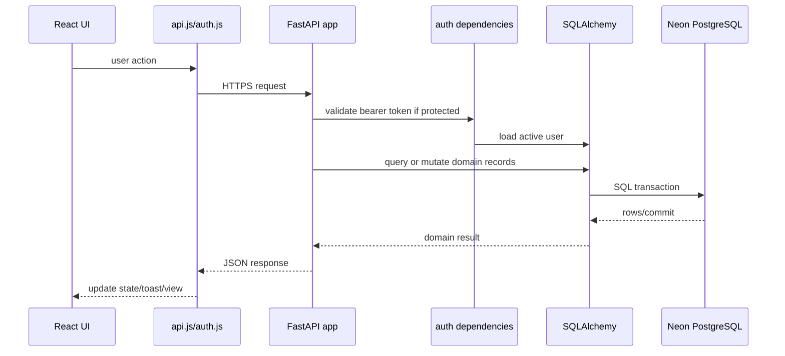
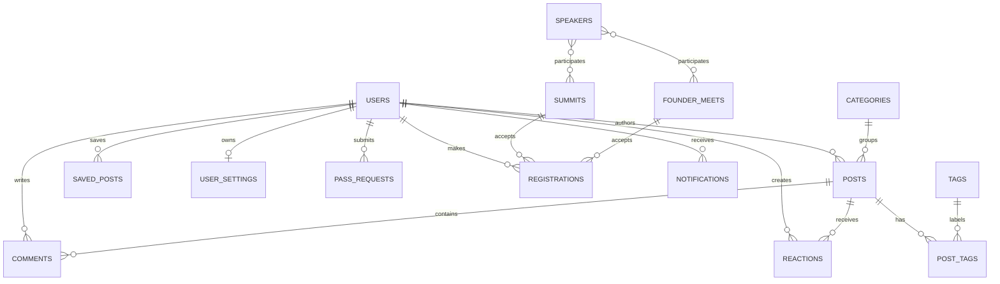
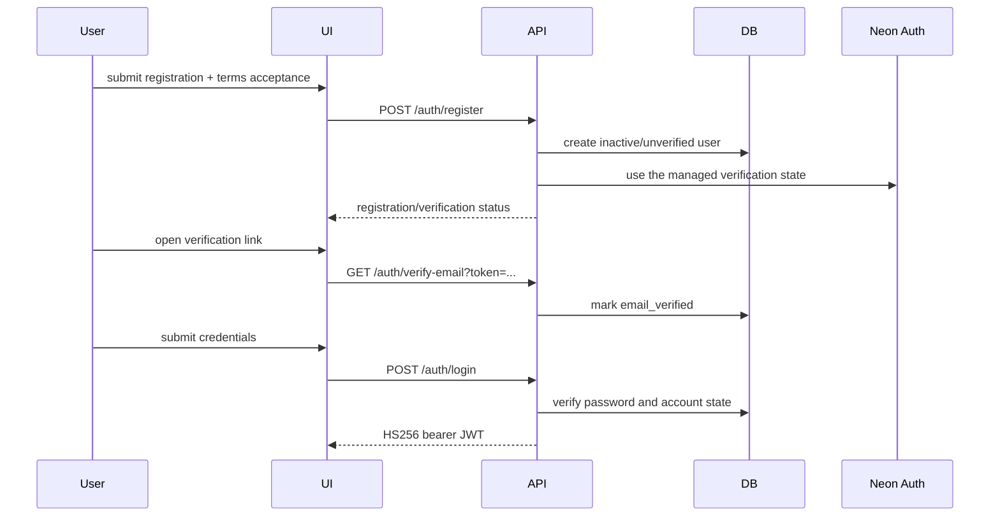
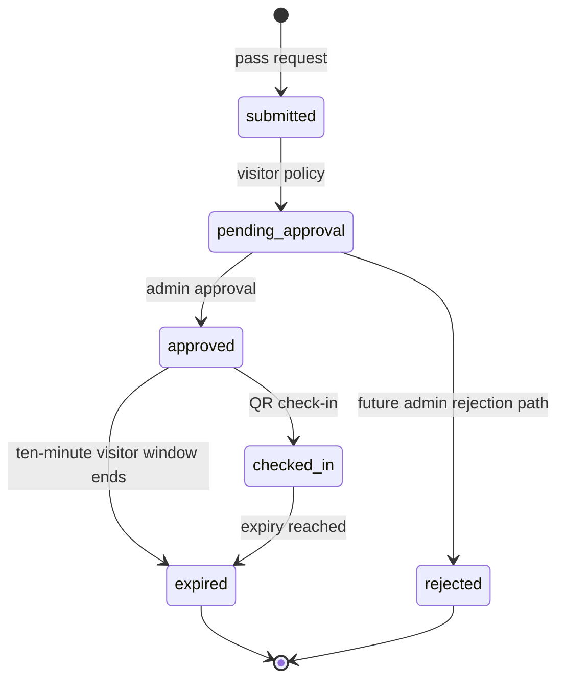
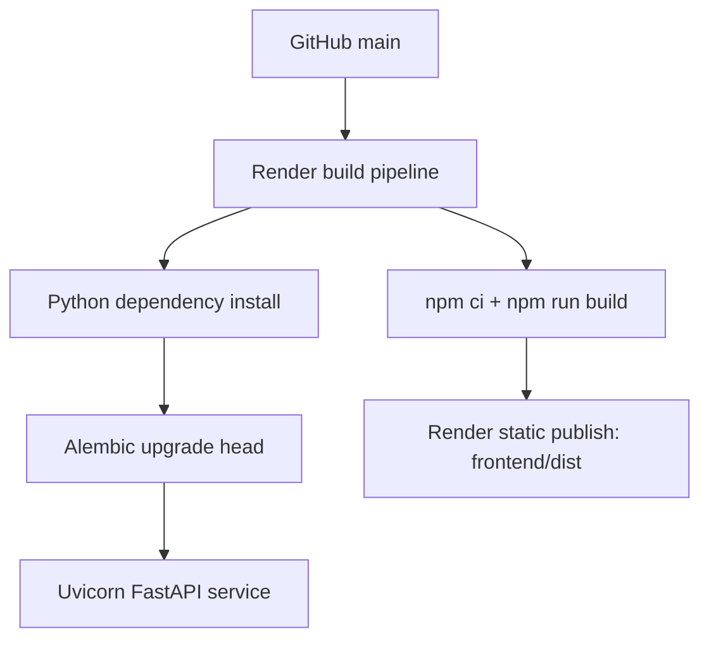

# NexziByte TechTalk System Architecture

**Architecture status:** Deployed state through commit `1dbecc4`; security and
quality checks are documented in `SECURITY.md` and
`.github/workflows/backend-quality.yml`.
**Frontend:** `https://techtalk-frontend-acvb.onrender.com`  
**Backend:** `https://techtalk-backend-shob.onrender.com`  
**Repository:** `ruchirachowdary-1836/nexzibytefull`  

## 1. System overview

NexziByte TechTalk is a browser-based community and events platform. It is
implemented as a React single-page application (SPA), a FastAPI REST API, and
a Neon PostgreSQL database. Render hosts both application services.

```mermaid
flowchart LR
    Browser[User browser]
    CDN[Render static service<br/>React/Vite dist]
    API[Render web service<br/>FastAPI + Uvicorn]
    DB[(Neon PostgreSQL)]
    NeonEmail[Neon Auth<br/>managed verification]
    NeonAuth[Neon Auth<br/>optional/conditional]

    Browser -->|HTTPS / SPA routes| CDN
    Browser -->|REST JSON + bearer token| API
    API -->|SQLAlchemy / pooled connection| DB
    API -->|verification state\| Neon Auth
    Browser -->|Neon Auth SDK| NeonAuth
    Browser -->|Neon JWT on API requests| API
```

## 2. Repository structure

```text
techtalk-backend-main/
├── app/
│   ├── main.py          # FastAPI application and route handlers
│   ├── models.py        # SQLAlchemy ORM models
│   ├── auth.py          # password hashing, JWT, user dependencies
│   ├── database.py      # engine, session factory, Base, get_db
│   ├── config.py        # environment-backed settings
│   └── seed/            # optional local/demo seed utilities
├── alembic/
│   ├── env.py
│   └── versions/        # ordered schema migrations
├── frontend/
│   ├── src/main.jsx     # SPA bootstrap and route composition
│   ├── src/context/     # global application state
│   ├── src/components/  # pages, sections, modals and workflows
│   ├── src/lib/api.js   # backend API client
│   ├── src/lib/auth.js  # authentication orchestration
│   ├── src/lib/neon.js  # Neon Auth/Data API client
│   └── src/data/        # presentation/catalog data
├── render.yaml          # Render services and environment wiring
└── requirements.txt     # Python dependencies
```

## 3. Frontend architecture

### 3.1 Runtime layers

1. **Bootstrap and routing**
   - `frontend/src/main.jsx` creates the React root, wraps the application with
     `AppProvider`, and defines React Router routes.
   - Render rewrites all static paths to `index.html`, allowing SPA routes such
     as `/events`, `/passes`, `/scanner`, and `/profile`.

2. **Global state**
   - `AppContext` owns authenticated user state, backend health state, modal
     state, selected event/course/internship, pass state, saved posts, and
     toast notifications.
   - Authentication is restored on startup through `authService.me()`.
   - User/profile values are loaded from the authenticated session rather than
     a default account object.

3. **Presentation and feature components**
   - Public experience: hero, community introduction, technical content,
     events, summits, founder meets, speakers, newsletter and FAQ.
   - Member experience: login/register, profile, saved content, event
     registration, digital pass and QR scanner.
   - Workflow modals: pass registration, event details, course application,
     internship application, article reader and login.

4. **Integration layer**
   - `lib/api.js` sends JSON requests to `VITE_API_URL`.
   - `lib/auth.js` selects the configured authentication path and normalizes
     the resulting user shape for the UI.
   - `lib/neon.js` initializes `@neondatabase/neon-js` when Neon Auth and Data
     API URLs are present and the provider is not explicitly `fastapi`.

### 3.2 Frontend route map

| Route | Responsibility |
|---|---|
| `/` | Public landing page and discovery sections |
| `/events` | Event listing |
| `/explore` | Technical articles and category filtering |
| `/summits`, `/summits/:id` | Summit listing and details |
| `/founder-meets`, `/founder-meets/:id` | Founder Meet listing and details |
| `/speakers` | Speaker discovery |
| `/courses` | Course discovery/application entry |
| `/internship` | Internship discovery/application entry |
| `/passes` | Pass request and digital-pass experience |
| `/scanner` | QR check-in UI |
| `/profile` | Authenticated member profile |

The application also uses hash targets such as `#digital-pass` and `#scanner`
for in-page navigation.

### 3.3 Frontend authentication behavior

The frontend supports two code paths:

- **Neon Auth path:** enabled when `VITE_NEON_AUTH_URL`,
  `VITE_NEON_DATA_API_URL`, and a non-`fastapi` provider setting are present.
  Email/password registration and login use Neon Auth. Google sign-in is
  initiated through the Neon Auth social provider.
- **FastAPI JWT fallback:** used when Neon Auth is disabled. Login submits
  OAuth2-compatible form fields to `POST /auth/login`; the returned JWT is
  stored under the frontend token key and sent as a bearer token.

The current Render configuration selects Neon Auth and still includes a Clerk
publishable-key variable/package from the earlier integration. Clerk is not
the active authentication implementation in `auth.js`.

## 4. Backend architecture

### 4.1 Request pipeline



### 4.2 Backend modules

- `app/main.py`
  - FastAPI application, CORS, startup compatibility checks, request models,
    response shaping, and REST endpoints.
- `app/auth.py`
  - bcrypt password hashing, password verification, HS256 access-token
    creation, current-user lookup, optional-user lookup, and admin guard.
- `app/database.py`
  - SQLAlchemy engine and request-scoped database sessions.
  - Uses SQLite locally when configured and PostgreSQL/Neon in production.
- `app/models.py`
  - Declarative schema and relationships.
- `app/config.py`
  - Environment-backed database, JWT, CORS, frontend and Neon Auth settings.
- Alembic
  - Migration chain is executed at Render startup before Uvicorn starts.

### 4.3 API domains

| Domain | Representative endpoints | Access |
|---|---|---|
| System | `/`, `/health` | Public |
| Authentication | `/auth/register`, `/auth/login`, `/auth/session`, `/auth/verify-email` | Mixed |
| Profile/settings | `/users/me`, `/auth/profile`, `/users/me/settings` | Authenticated |
| Users/admin | `/users`, `/users/{id}`, status operations | Admin for management |
| Content | `/posts`, `/categories`, `/tags`, search/trending/featured | Public/member/admin by operation |
| Community | comments, reactions, saves, notifications | Authenticated for mutations |
| Events | `/events/upcoming`, `/summits`, `/founder-meets`, `/speakers` | Public/member/admin by operation |
| Registrations | `/registrations` | Authenticated |
| Passes | `/pass-requests`, `/users/me/pass-requests` | Public submission/member read |
| Pass approval | `/admin/pass-requests`, approval endpoint | Admin |
| Applications | `/course-applications` | Public/member |
| Marketing | `/newsletter/subscribe`, `/partnership-inquiries` | Public |
| Dashboards | `/dashboard/*`, `/admin/dashboard` | Admin |

## 5. Persistence architecture

Neon PostgreSQL is the production source of truth. SQLAlchemy maps the
following main bounded areas:



Important entities include:

- **Identity:** `users`, `user_settings`, `user_skills`, `user_links`
- **Community:** `categories`, `tags`, `posts`, `post_tags`, `comments`,
  `reactions`, `saved_posts`, `notifications`
- **Events:** `speakers`, `summits`, `founder_meets`, association tables and
  `registrations`
- **Commercial/lead workflows:** `pass_requests`, `course_applications`,
  `partnership_inquiries`, `newsletter_subscribers`

### 5.1 Migration state

The latest application migration is `0012_auth_pass_policy`. It adds:

- user email verification state and token expiry;
- user referral contact;
- pass-request phone and referral contact;
- pass-request expiry timestamp.

Earlier migrations add official event data and issued digital-pass fields.
Render runs `python -m alembic upgrade head` as part of the service start
command.

The application also contains startup compatibility checks that add selected
columns when an older deployed database is missing them. Alembic remains the
authoritative schema evolution mechanism.

## 6. Authentication and authorization

### 6.1 FastAPI JWT flow



Roles currently represented by the backend are primarily `user` and `admin`.
`require_admin` permits only `role == "admin"` for administrative endpoints.
There is not yet a separate staff/HR role policy in the authorization
dependency.

### 6.2 Neon Auth flow

When enabled, the browser uses the Neon SDK for session creation and obtains a
Neon JWT. `api.js` attaches that token to API calls. The current FastAPI
dependency implementation validates its own HS256 JWT format and does not yet
validate Neon JWTs against Neon Auth JWKS or synchronize a Neon identity into a
local `users` row. Therefore, Neon Auth UI activation and FastAPI-protected
endpoint compatibility are separate deployment concerns.

## 7. Pass lifecycle



The current implementation:

1. accepts pass-request contact and referral information;
2. keeps visitor requests pending approval;
3. creates `pass_id`, `qr_data`, and `issued_at` on approval;
4. sets visitor `expires_at` to ten minutes after approval;
5. exposes credentials to the digital-pass UI only when the response contains
   an issued pass.

The promotion-day rule is a product requirement but is not yet represented by
a promotion-date field/configuration or enforced by a dedicated date check.
QR check-in is currently coordinated through frontend state; a durable
backend check-in record/validation endpoint is not yet present.

## 8. Deployment architecture



### Backend Render service

- Runtime: Python web service
- Build: `pip install -r requirements.txt`
- Start:
  `python -m alembic upgrade head && uvicorn app.main:app --host 0.0.0.0 --port $PORT`
- Health check: `/health`
- Required production variables include `DB_URL`, `JWT_SECRET`,
  `CORS_ORIGINS`, and `FRONTEND_URL`.
- Neon Auth variables are supported by the code but are not present in the checked
  `render.yaml` configuration.

### Frontend Render service

- Runtime: static site
- Root: `frontend`
- Build: `npm ci && npm run build`
- Publish directory: `dist`
- SPA rewrite: all paths to `/index.html`
- Runtime variables include the API URL and Neon Auth/Data API URLs.

## 9. Security boundaries

- HTTPS terminates at Render.
- Browser-to-API calls use CORS allow-list configuration.
- Passwords are stored as bcrypt hashes, never plaintext.
- FastAPI protected routes require bearer authentication.
- Admin operations use a backend role dependency; hiding an admin link in the
  frontend is not the security boundary.
- Database access is server-side through SQLAlchemy for the main application
  API.
- Neon Data API access from the browser is conditional and must be protected
  by Neon Auth/RLS policies before being used for sensitive data.
- Secrets such as `DB_URL`, `JWT_SECRET`, and identity-provider credentials should remain
  Render environment variables and must not be committed.

## 10. Implemented versus remaining integration items

### Implemented through `1dbecc4`

- React/Vite frontend deployed independently from FastAPI backend.
- Neon PostgreSQL persistence and Alembic migrations.
- Neon JWT authentication for protected API routes.
- Neon Auth-managed email verification.
- Referral contact persistence for users and pass requests.
- Terms-aware registration payload.
- Neon Auth client and Google sign-in initiation.
- Visitor-pass approval state, issued QR data, and ten-minute expiry fields.
- Backend/admin pass approval endpoint.
- Profile, events, community, registrations and marketing API surfaces.

### Configuration or follow-up required

- Configure a real Neon Auth in Render for actual verification email
  delivery.
- Enable/configure Google as a provider in the Neon Auth project.
- Validate Neon JWTs in FastAPI, or provide a controlled identity-sync/session
  bridge for Neon-authenticated users accessing protected API routes.
- Add explicit staff/HR roles and enforce them separately from generic admin.
- Add promotion-date configuration and enforce visitor eligibility by date.
- Move QR validation/check-in to a backend endpoint with durable audit data.
- Add a frontend verification-result route/page if the current SPA does not
  already render the verification callback.
- Replace remaining presentation-only mock/catalog data where a feature is
  expected to be fully backend-managed.

## 11. Verification performed at this update

- Frontend production build completed successfully with Vite.
- Python compilation passed for changed backend and migration files.
- `git diff --check` passed before commit.
- Render backend health endpoint returned HTTP 200.
- Render frontend returned HTTP 200.

## 12. Security and delivery checks

`SECURITY.md` is the operational security checklist and reporting guide. The
backend workflow in `.github/workflows/backend-quality.yml` runs on pushes to
`main` and pull requests with read-only repository permissions. It installs the
declared Python dependencies and CI-only tooling, then runs:

- Ruff for linting;
- mypy with missing third-party stubs ignored;
- pytest with coverage reporting (without imposing a repository-wide threshold
  until a baseline is agreed);
- pip-audit against the declared requirements; and
- an Alembic offline SQL render. The step is explicitly non-blocking because
  some legacy migrations use live-table reflection and cannot render offline;
  production migration execution still requires a staged database rehearsal.

Coverage and the rendered migration SQL are retained as workflow artifacts when
available. The workflow uses only non-production CI environment values; real
database, identity-provider, and signing secrets must be supplied by the
deployment platform.
